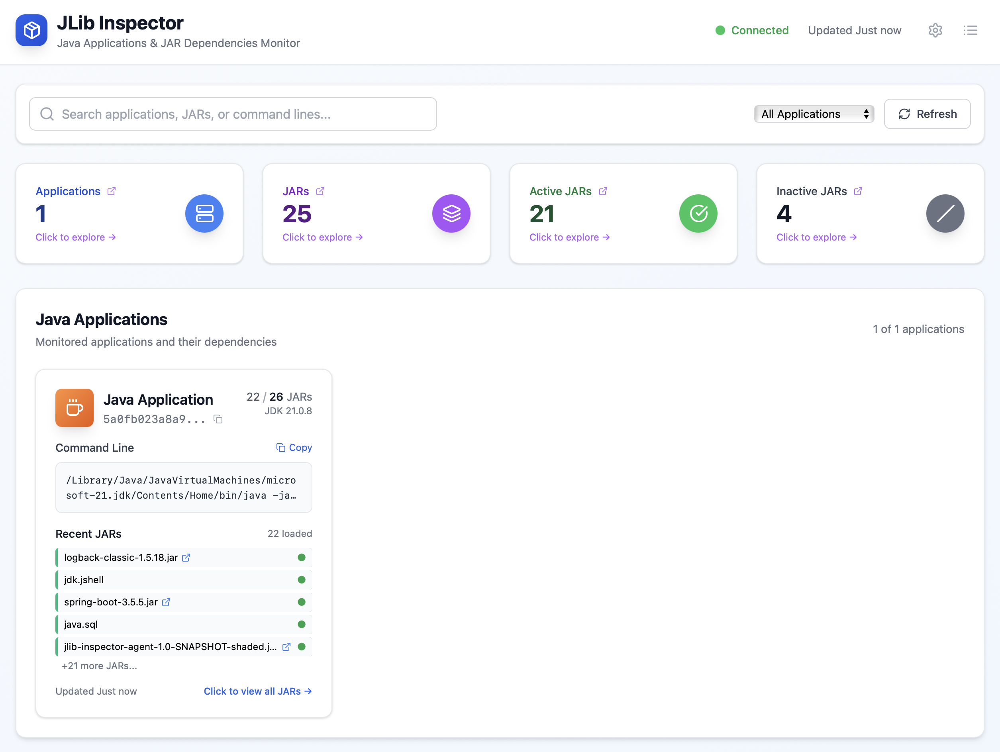
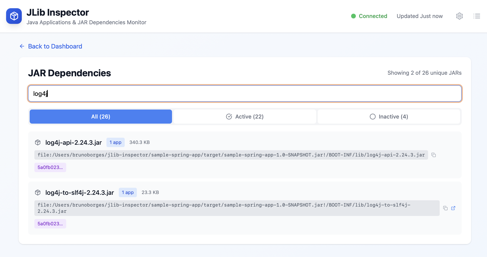

# JLib Inspector

> **⚠️ EXPERIMENTAL - NOT PRODUCTION READY**  
> This project is currently in experimental/development phase and is **not suitable for production environments**. Use for development, testing, and evaluation purposes only.

<!-- BADGES -->
[](https://github.com/brunoborges/jlib-inspector/actions/workflows/ci.yml)
[](https://opensource.org/licenses/MIT)
[](https://openjdk.java.net/)
[](https://nodejs.org/)
<!-- /BADGES -->

A comprehensive Java application monitoring dashboard that tracks JAR dependencies loaded during application runtime. The system consists of a Java agent, a standalone data collection server, and a modern React-based web dashboard to exemplify data visualization.

**Getting started:** [Using JLib Inspector](#using-jlib-inspector) | [OpenTelemetry export](#opentelemetry-export) | [Contributing and building from source](#contributing-and-building-from-source)

## 🎯 Why JLib Inspector?

When security vulnerabilities like **Log4Shell** strike, organizations face a critical challenge: **identifying which production systems are affected**. During the Log4j vulnerability crisis, many teams struggled with fundamental questions:

- *"Which of our production applications use Log4j?"*
- *"What version are they running?"*
- *"Are there transitive dependencies we don't know about?"*
- *"How can we quickly assess our exposure across hundreds of services?"*

**The Traditional Approach is Reactive and Error-Prone:**
- 🔍 Manual inspection of deployment artifacts
- 📂 Digging through production file systems
- 📋 Relying on outdated documentation or build scripts
- ⏰ Time-consuming emergency audits during critical security incidents
- 🎯 Missing transitive dependencies hidden deep in the dependency tree

**JLib Inspector Enables Proactive Dependency Visibility:**
- 🚀 **Real-time monitoring** of actual JAR files loaded by running JVMs
- 🎯 **Complete visibility** including transitive dependencies
- 📊 **Centralized dashboard** showing all applications and their dependencies
- 🔄 **Continuous tracking** of what's actually running vs. what's deployed
- ⚡ **Instant response** capability when new vulnerabilities are disclosed
- 🛡️ **Proactive security posture** instead of reactive emergency responses

**Production Reality Check:**
Unlike static analysis of build files, JLib Inspector shows you **exactly what JARs are loaded at runtime** - capturing the full picture including:
- JARs loaded dynamically through plugins or extensions
- Nested JARs within fat/uber JARs  
- Platform-specific dependencies loaded conditionally
- The actual classpath used by the running JVM

When the next security vulnerability emerges, you'll have immediate answers instead of emergency archaeology. 

## 🏗️ Architecture

- **Java Agent**: Instruments Java applications to track JAR loading and usage (shaded agent JAR)
- **JLib Server**: Standalone server that collects and aggregates data from instrumented applications (Port 8080, shaded server JAR)
- **Web Dashboard**: React-based frontend with real-time updates (Ports 3000 for http and 3001 for websocket)

## Using JLib Inspector

You do **not** need Maven or a source build to use the released agent and server JARs. Download them from [GitHub Releases](https://github.com/brunoborges/jlib-inspector/releases/latest). If you want to modify the project or build it yourself, see [Contributing and building from source](#contributing-and-building-from-source).

### Runtime requirements

| What you want to run | What you need |
| --- | --- |
| Java agent | Java 21+ in the application JVM and the released shaded agent JAR |
| JLib Server | Java 21+ runtime and the released shaded server JAR |
| Dashboard directly on your machine | Node.js 18.12+ and npm; the setup below builds the frontend locally |
| Containerized setup | Docker and Docker Compose; build tools run inside the containers |

The server and dashboard are optional: you can use the agent in local-only mode or export to OpenTelemetry without either. Node.js is **not** required in the JVM running the agent or on a machine running only the JLib Server.

### 1. Download the agent and optional server

From the same release, download:

- `jlib-inspector-agent-<version>-shaded.jar`
- `jlib-inspector-server-<version>-shaded.jar` if you want centralized collection

For the commands below, rename these files to `jlib-inspector-agent.jar` and `jlib-inspector-server.jar`, respectively. Run the commands from the directory containing the downloaded JARs.

To use the agent without a server or dashboard:

```bash
java -javaagent:jlib-inspector-agent.jar -jar /path/to/your-application.jar
```

### 2. Collect data with the server (optional)

Start the server:

```bash
java -jar jlib-inspector-server.jar 8080
```

In another terminal on the same machine, run your application with server reporting enabled:

```bash
java "-javaagent:jlib-inspector-agent.jar=server:8080" -jar /path/to/your-application.jar
```

The agent reports when the application JVM shuts down by default. See [Agent Configuration](#agent-configuration), [OpenTelemetry Export](#opentelemetry-export), and [Periodic Reporting](#periodic-reporting-optional) for additional options.

### 3. Start the dashboard (optional)

The dashboard connects to the JLib Server. To run it directly on your machine, you need Node.js and npm, but **not Maven**. In another terminal, get the frontend source and start it:

```bash
git clone https://github.com/brunoborges/jlib-inspector.git
cd jlib-inspector/frontend
npm install
npm start
```

`npm start` builds the React frontend and starts Express at **http://localhost:3000**, connecting to **http://localhost:8080** by default. Set `JLIB_SERVER_URL` if the server is elsewhere. If you already have the repository, use its `frontend/` directory instead of cloning again.

For a containerized setup instead, see the Docker section below.

## OpenTelemetry Export

The Java agent can send each JAR in its inventory as an OpenTelemetry `package.info` log event to an OTLP/HTTP-compatible collector. This works independently of the JLib Server and dashboard; nothing is exported unless you enable the `otel` option.

```bash
# Export when the application exits
java "-javaagent:jlib-inspector-agent.jar=otel:http://collector:4318" -jar /path/to/your-application.jar

# Also export updates every 5 minutes while it runs
java "-javaagent:jlib-inspector-agent.jar=otel:http://collector:4318,interval:5m" -jar /path/to/your-application.jar
```

The endpoint can be omitted to use `OTEL_EXPORTER_OTLP_LOGS_ENDPOINT` or `OTEL_EXPORTER_OTLP_ENDPOINT` (default `http://localhost:4318`). The generic endpoint gets `/v1/logs` appended. The agent sends the full inventory on its first report and only new or changed archives afterward. It supports OTLP over `http/json`; no OpenTelemetry SDK or additional application dependencies are required.

Events use attribute names from the [OpenTelemetry Java agent's experimental package emitter](https://github.com/open-telemetry/opentelemetry-java-instrumentation/tree/main/instrumentation/runtime-telemetry), and also include JARs that were declared but never loaded and JARs nested inside fat JARs.

| Attribute | Description |
| --- | --- |
| `package.path` / `package.type` | Archive file name / extension (`jar`, `war`, `ear`) |
| `package.name` / `package.version` | `groupId:artifactId` and version from `pom.properties` (version falls back to the manifest) |
| `package.description` | Manifest `Implementation-Title` and `Implementation-Vendor` |
| `package.checksum` / `package.checksum_algorithm` | Hex SHA-256 / `SHA-256` |
| `jlib.jar.path` | Full path, including nested `!/BOOT-INF/lib/...` entries |
| `jlib.jar.loaded` / `jlib.jar.nested` / `jlib.jar.size` | Whether classes were loaded from it, whether it is nested, size in bytes |

Resource attributes include `service.name`, `process.*`, `host.name` and `jlib.application.id`. `OTEL_EXPORTER_OTLP_HEADERS` / `OTEL_EXPORTER_OTLP_LOGS_HEADERS` configure headers, and `OTEL_SERVICE_NAME` / `OTEL_RESOURCE_ATTRIBUTES` configure resource identity. The resource includes `process.command_line`, so avoid putting secrets on the application command line.

## 🐳 Running with Docker

The repository includes Docker Compose setup for development and evaluation. It builds from source **inside containers**, so you do not need Java, Maven, or Node.js installed on the host for the included services. You need Docker, Docker Compose, and a copy of this repository.

**Quick Docker Start:**
```bash
# Start all services with Docker Compose (runs from repo root)
./docker/start-docker.sh
```

The Docker setup includes:
- **Backend container** (JLib Server on port 8080)
- **Frontend container** (Dashboard on port 3000)  
- **Sample application** instrumented with the Java agent
- **Automatic networking** between containers

📁 **For detailed Docker setup instructions, configuration options, and troubleshooting, see the [docker/README.md](docker/README.md) file.**

## 🌐 Access the Dashboard

Open your browser and navigate to: **http://localhost:3000**

### Screenshots

Main dashboard:



JAR list:



### Dashboard Features

- **📊 Real-time Application Monitoring**: Live view of all instrumented Java applications
- **🔍 JAR Dependency Analysis**: Complete view of loaded and available JARs
- **📋 Command Line Display**: Full command used to start each application
- **🔗 MvnRepository Integration**: Direct links to search Maven repositories
- **📋 Copy Functionality**: One-click copy for checksums and application IDs
- **🏷️ Tabbed JAR View**: Organized view of All/Loaded/Not Loaded JARs
- **🔍 Search & Filter**: Find applications and JARs quickly
- **📱 Responsive Design**: Works on desktop and mobile

## 📡 API Endpoints

### JLib Server (Port 8080)
- `GET /health` - Server health check
- `GET /api/apps` - List all monitored applications
- `GET /api/apps/{appId}` - Get specific application details
- `GET /api/apps/{appId}/jars` - Get JAR dependencies for an application
- `PUT /api/apps/{appId}` - Register/update application data
 - `GET /report` - Aggregated unique JARs across all apps with the list of apps that loaded each

### Dashboard API (Port 3000)
- `GET /api/dashboard` - Combined dashboard data
- `GET /api/health` - Dashboard health status

## 🔧 Configuration

### Agent Configuration
The agent accepts the following parameters (combine several with commas):

```bash
# Local mode only (no server reporting)
-javaagent:jlib-inspector-agent.jar

# Report to local server
-javaagent:jlib-inspector-agent.jar=server:8080

# Report to remote server
-javaagent:jlib-inspector-agent.jar=server:remote-host:9000

# Export OpenTelemetry events (endpoint from OTEL_EXPORTER_OTLP_* env vars, default http://localhost:4318)
-javaagent:jlib-inspector-agent.jar=otel

# Report to the server and export to a specific OTLP/HTTP collector
-javaagent:jlib-inspector-agent.jar=server:8080,otel:http://collector:4318

# Also report every 30 seconds while the application runs (units: s, m, h)
-javaagent:jlib-inspector-agent.jar=server:8080,interval:30s
```

`JLIB_SERVER_URL`, when set, overrides the `server:` option. Other options still apply.

### Periodic Reporting (optional)

By default the agent reports once, when the JVM shuts down. Long-running services may never stop, so add `interval:<duration>` to also report while the application runs (for example `interval:30s`, `interval:5m` or `interval:1h`; a bare number is seconds, minimum `1s`). The agent still reports at shutdown.

- **jlib server**: each report sends the full inventory. The server merges it into the existing application and refreshes its last-updated time. JARs that load lazily show up as loaded without waiting for shutdown.
- **OpenTelemetry**: the first report exports every archive. Later reports export only new archives or archives whose state changed, such as a declared JAR that is now loaded. When nothing changed, nothing is sent. A failed export is retried on the next report.

### Environment Variables
```bash
# JLib Server URL (default: http://localhost:8080)
$env:JLIB_SERVER_URL = "http://localhost:8080"

# Dashboard port (default: 3000)
$env:PORT = "3000"

# WebSocket port (default: 3001)
$env:WS_PORT = "3001"
```

## 🐛 Troubleshooting

### Common Issues

**Dashboard shows "No applications":**
- Ensure JLib Server is running on port 8080
- Verify Java applications are started with the `-javaagent` parameter
- Check that applications are connecting to the correct server

**Build failures:**
- Check the [build prerequisites](#build-prerequisites); these apply to source builds, not downloaded JARs
- Clean Java build outputs: `./mvnw clean`
- Check for port conflicts (8080, 3000, 3001)

**WebSocket connection issues:**
- Verify no firewall blocking ports 3000-3001
- Check browser console for connection errors
- Restart the dashboard server

### Logs and Debugging

**Enable verbose agent logging:**
```bash
java -Djava.util.logging.config.file=logging.properties -javaagent:jlib-inspector-agent.jar=server:8080 -jar your-app.jar
```

**Check server logs:**
```powershell
# JLib Server logs appear in console
# Dashboard logs appear in console with timestamp
```

## Contributing and building from source

This section is for changing JLib Inspector or building your own artifacts. To use released JARs without building the Java modules, follow [Using JLib Inspector](#using-jlib-inspector) instead.

### Build prerequisites

- **JDK 21+**, with `JAVA_HOME` set
- **Maven 4+**, provided by the included wrapper (`./mvnw` on Linux/macOS, `mvnw.cmd` on Windows); no separate Maven installation is needed
- **Node.js 18.12+ and npm** if you are building or running the dashboard from source
- **Git** to clone the repository
- **Bash** for the shell examples, or **PowerShell** for the Windows demo script

### Build and test

```bash
git clone https://github.com/brunoborges/jlib-inspector.git
cd jlib-inspector

# Build and test all Java modules, including the sample application
./mvnw clean verify

# Run Java unit tests without packaging
./mvnw test
```

The Java build produces shaded agent and server JARs under `agent/target/` and `server/target/`, and the sample application under `sample-spring-app/target/`. Their filenames include the version from the root `pom.xml`.

Build the dashboard separately; Maven does not build it. Run npm commands from `frontend/`:

```bash
cd frontend
npm install
npm run build
```

The frontend's `npm test` script is currently a no-op; check dashboard changes against the running server and sample application.

### Run the development environment

After building, run these commands in separate terminals, starting from the repository root. Replace `<version>` with the version in the root `pom.xml`.

```bash
# Terminal 1: Start the locally built server
java -jar "server/target/jlib-inspector-server-<version>-shaded.jar" 8080

# Terminal 2: Build and start the dashboard
cd frontend
npm start

# Terminal 3: Run the sample application with the locally built agent
java "-javaagent:agent/target/jlib-inspector-agent-<version>-shaded.jar=server:8080,interval:30s" -jar "sample-spring-app/target/sample-spring-app-<version>.jar"
```

Open **http://localhost:3000**. The sample reports while it runs with `interval:30s`, as well as at shutdown. Make your changes, rerun the relevant build/tests, and exercise the sample application before submitting a pull request.

### Demo scripts

After installing the build prerequisites, you can also run the comprehensive testing script from the repository root:

**Windows (PowerShell):**
```powershell
# Comprehensive test of all agent modes and server integration
.\demo-jlib-inspector.ps1
```

**Linux/macOS (Bash):**
```bash
# Comprehensive test of all agent modes and server integration
./demo-jlib-inspector.sh
```

These scripts will:
1. Build the project automatically
2. Test local-only mode (no server arguments)
3. Test server mode with graceful fallback
4. Test full server integration when server is available
5. Test custom host:port argument formats
6. Display comprehensive results and usage examples

**Prerequisites for bash script:**
- `curl` (for server health checks)
- `java` and Maven wrapper `./mvnw` (automatically checked)

### Project structure

```
jlib-inspector/
├── agent/                # Java Agent module (produces shaded agent JAR)
├── common/               # Shared code used by agent and server
├── server/               # Standalone JLib Server module (produces shaded server JAR)
├── sample-spring-app/    # Sample Spring Boot application
├── frontend/             # React dashboard (Express-based)
├── docker/               # Dockerfiles, compose, helper script
├── site/                 # GitHub Pages documentation
├── README.md             # Project overview (this file)
└── DOCKER.md             # Docker-specific docs
```

## 🎯 Key Features

### For Developers
- **Real-time JAR tracking** - See which dependencies are actually used
- **Performance insights** - Identify unused JARs for optimization
- **Dependency analysis** - Complete visibility into application dependencies
- **Command line monitoring** - Full startup command with arguments

### For Operations
- **Live monitoring** - Real-time view of all Java applications
- **Health checking** - Monitor application and server status
- **Resource tracking** - JAR file sizes and checksums
- **Historical data** - First seen and last updated timestamps

## Articles

- [Building a Runtime JAR inspector in 10 hours](https://devblogs.microsoft.com/java/building-a-runtime-jar-inspector-in-10-hours/)

## 📖 Documentation

Complete documentation is available on the [project website](https://brunoborges.github.io/jlib-inspector), including:

- **Getting Started Guide** - Step-by-step setup instructions
- **Agent Documentation** - Detailed agent usage and configuration
- **Server Documentation** - Backend setup and API reference
- **API Reference (Javadoc)** - Complete code documentation
- **Screenshots** - Visual overview of the dashboard

### Preview documentation page locally

```bash
docker run --rm -p 4000:4000 -v "$PWD/docs":/srv/jekyll -w /srv/jekyll jekyll/jekyll:4 \
  bash -lc "bundle install && jekyll serve --livereload --host localhost"
```

Open http://localhost:4000 in your browser.

## 📄 License

MIT License - see LICENSE file for details.
